# Exile Delta

**게임에서 Ctrl+C 한 번으로 PoB 아이템 비교**

POE1을 하다 보면 아이템을 주울 때마다 PoB를 켜서 붙여넣고 비교하는 일이 꽤 번거롭습니다.
그래서 게임 안에서 아이템에 `Ctrl+C`만 누르면 **내 캐릭터 기준 DPS · EHP · 최대 피격 변화가 바로 뜨는 프로그램**을 만들었습니다.

- 계산은 **Path of Building(PoB) 원본 엔진**을 그대로 돌려서 합니다. PoB에서 직접 비교한 값과 숫자가 같습니다.
- **한글 클라이언트**에서 복사한 아이템도 자동으로 영문으로 바꿔서 계산합니다.
- 무료이고, 소스 코드를 모두 공개했습니다.

**[다운로드 (최신 버전)](../../releases/latest)**

> For English speakers: a Windows tool for Path of Exile 1. Press `Ctrl+C` on an item in game and it shows how your DPS / EHP / max hit would change, using the real Path of Building engine. Works with the Korean client too.

---

## 주요 기능

### 1. Ctrl+C 한 번으로 아이템 비교 · 옵션별 분석

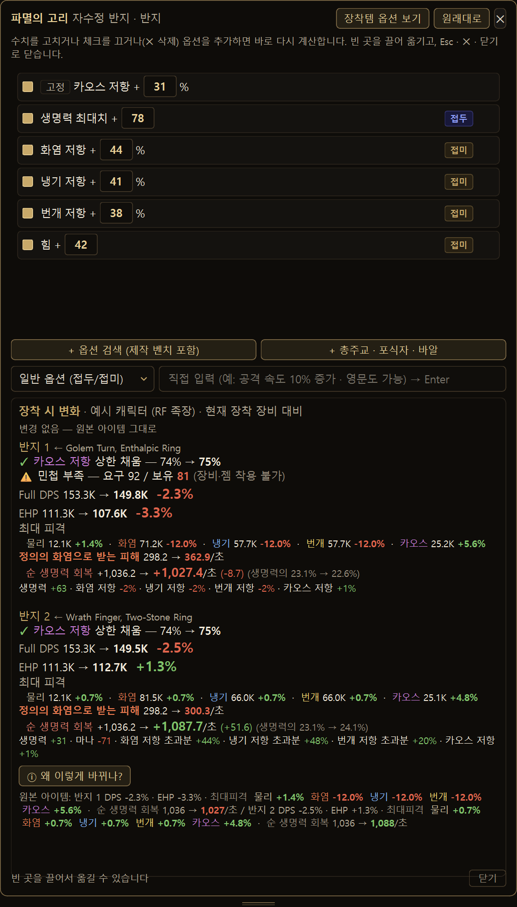

게임에서 아이템에 마우스를 올리고 `Ctrl+C`를 누르면 비교 창이 바로 뜹니다.

- 옵션은 **접두끼리, 접미끼리** 모아서 보여주고, 줄 오른쪽에 접두인지 접미인지 표시합니다. "물리 피해 % + 정확도"처럼 두 줄짜리 옵션은 한 묶음으로 보여줍니다.
- 반지처럼 낄 자리가 두 곳이면 **자리마다 따로** 계산해서 보여줍니다.
- Full DPS, EHP, 최대 피격(물리 · 화염 · 냉기 · 번개 · 카오스) 변화가 한눈에 보입니다.
- **저항이 상한 밑으로 떨어지거나 힘 · 민첩 · 지능이 모자라면** 경고가 뜹니다.
- 정의의 화염(RF)처럼 스스로 피해를 받는 빌드는 **순 생명력 회복** 변화까지 계산합니다.
- 옵션을 끄거나 수치를 바꾸거나, 총주교 · 포식자 · 바알 옵션을 붙여 보면서 바로 다시 계산할 수 있습니다.

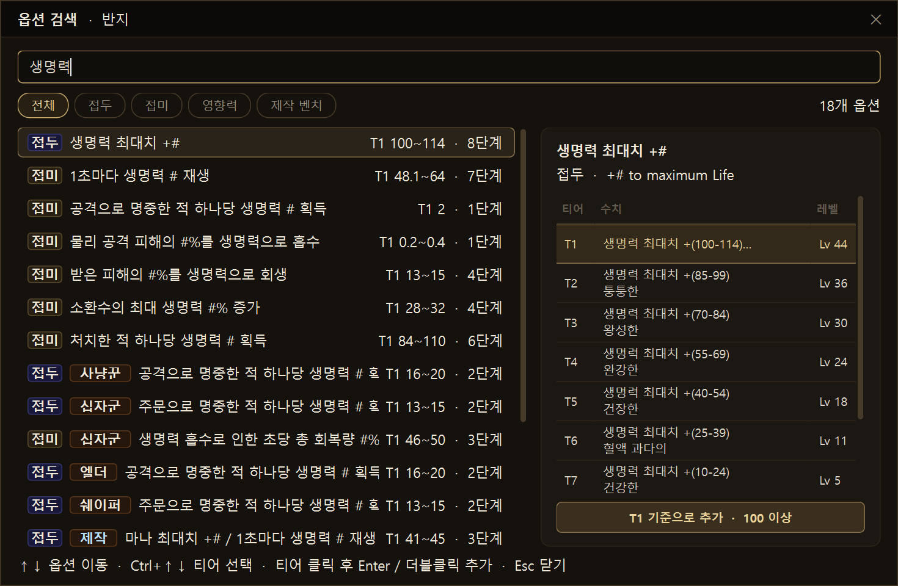

- **+ 옵션 검색** 을 누르면 그 부위에 붙을 수 있는 옵션을 한글 · 영문으로 찾아서 붙여 볼 수 있습니다. 제작 벤치 옵션도 들어 있습니다.
- 옵션마다 티어별 수치와 필요 레벨이 나오고, 고른 티어의 최고 수치로 붙습니다.

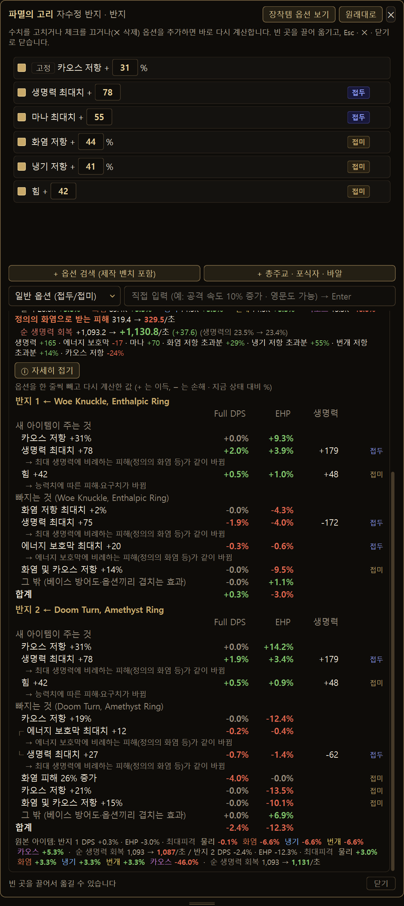

- **"왜 이렇게 바뀌나?"** 버튼을 누르면 새 아이템이 주는 옵션과 빠지는 옵션이 한 줄마다 DPS · EHP에 얼마나 영향을 주는지 나눠서 보여줍니다.

### 2. 내 캐릭터 한눈에 보기

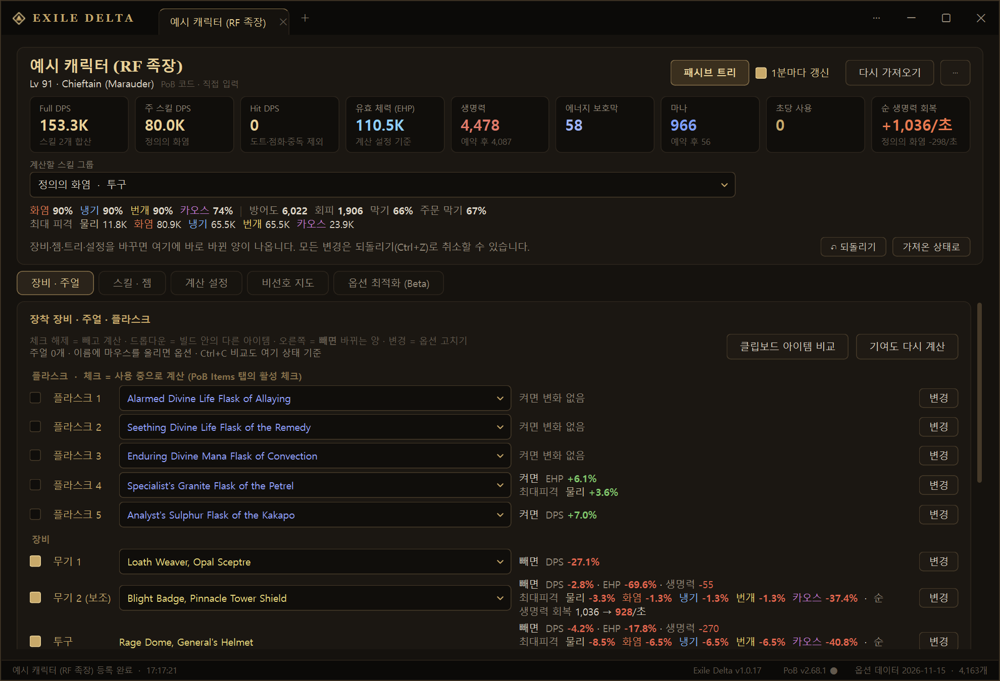

- pathofexile.com 계정 이름이나 PoB 코드 · 링크(pobb.in, poe.ninja 등)로 캐릭터를 불러옵니다.
- **"1분마다 갱신"** 을 켜 두면 레벨업, 장비 교체, 패시브 변경이 알아서 반영됩니다. 사이트 요청 제한에 걸리지 않게 알아서 조절합니다.
- 장비 · 플라스크를 하나씩 뺐을 때 DPS · EHP가 얼마나 줄어드는지, 즉 **장비별 기여도**를 보여줍니다.
- 위쪽 줄에서 캐릭터 레벨, 계산할 스킬, 스킬 파트, **단계 수**(작열 광선처럼 쌓이는 스킬), 토템 · 소환수 수를 PoB 사이드바처럼 바꿔 볼 수 있습니다.
- 젬 켜기/끄기, Full DPS 체크, 주 스킬, 계산 설정, 플라스크는 다시 불러와도 그대로 유지됩니다.

### 3. 스킬 · 젬, 계산 설정

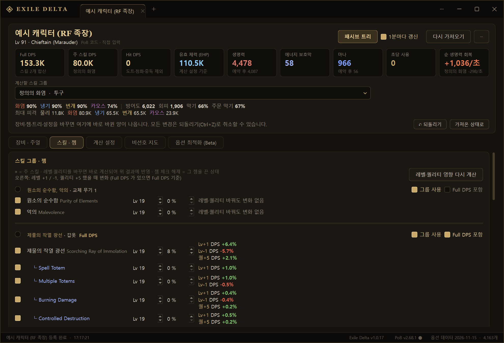

- 젬 레벨 +1 / -1, 퀄리티 +5를 했을 때 효과를 미리 계산해 줍니다.
- 엘더 투구의 "장착된 젬이 레벨 N 화상 피해 보조를 받음"처럼 **아이템이 붙여 주는 보조젬**도 그 스킬 밑에 "(아이템)"으로 같이 보입니다.

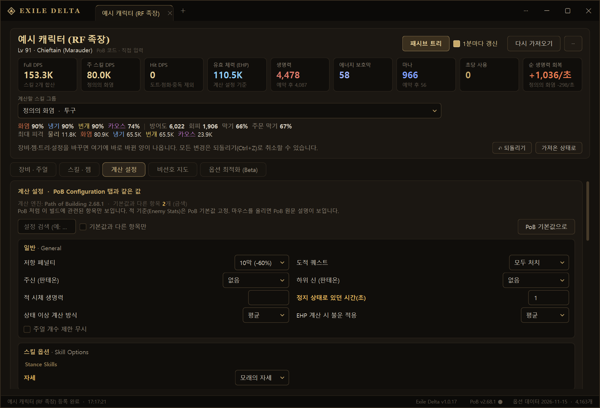

- PoB의 Configuration 탭과 같은 계산 설정을 한글로 바꿀 수 있습니다. 이 빌드에 관련된 항목만 보여 줍니다.
- 보스 종류, 적 레벨, 적 저항, 보스 스킬 프리셋 같은 **적 설정**도 PoB와 똑같이 바꿀 수 있습니다.

### 4. 패시브 트리 미리 찍어 보기


노드에 마우스를 올리면 **찍었을 때 DPS · EHP 변화**를 바로 계산합니다. 노드 검색은 한글 · 영문 둘 다 됩니다.
여기서 바꾼 트리는 바로 저장되고, `Ctrl+C` 아이템 비교도 이 트리를 기준으로 계산합니다.

### 5. 목걸이 성유(Anoint) 미리 발라 보기

목걸이에 `Ctrl+C`를 하면 아래에 **+ 성유 옵션** 버튼이 생깁니다.

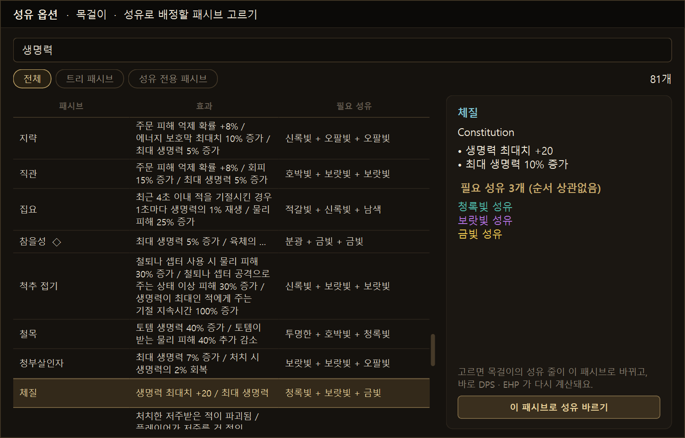

- 패시브 이름, 효과, 성유 이름(예: "체질", "생명력", "금빛")으로 검색하면 **패시브 / 효과 / 필요한 성유 3개**가 같이 나옵니다.
- 목록은 PoB의 최신 패시브 트리에서 읽어 오기 때문에, 리그가 바뀌어도 PoB가 업데이트되면 알아서 따라갑니다.

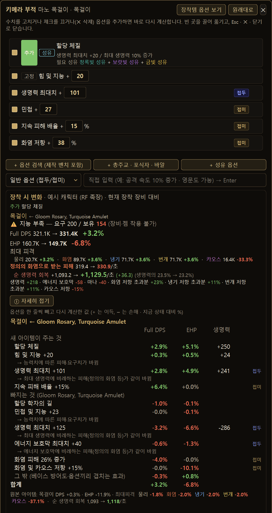

- 고르면 목걸이의 성유 줄이 그 패시브로 바뀌고, 다른 옵션과 똑같이 DPS · EHP 변화와 "왜 이렇게 바뀌나?"까지 바로 다시 계산합니다.
- 이미 성유가 발린 목걸이도 성유 줄에 효과와 필요한 성유가 같이 표시됩니다.

### 6. 지도 비선호 옵션 경고

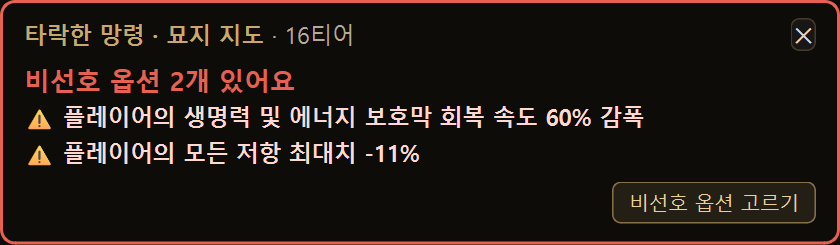

내 빌드로 돌기 싫은 지도 옵션(예: 회복 속도 감소, 최대 저항 감소)을 미리 골라 두면, 지도에 `Ctrl+C`를 했을 때 해당 옵션이 있는지 바로 알려줍니다.

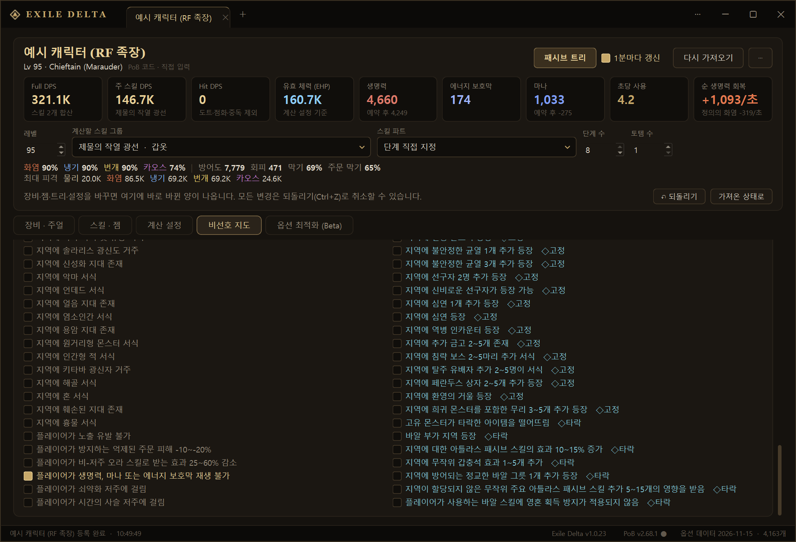

- 일반 접두/접미뿐 아니라 지도 **고정 옵션**(환영의 거울, 심연, 역병 등)과 **바알 오브 타락 옵션**도 고를 수 있습니다.
- 메이븐 초대장 같은 "기타 지도 아이템"도 지도와 똑같이 검사합니다.

### 7. 알아서 최신 상태 유지

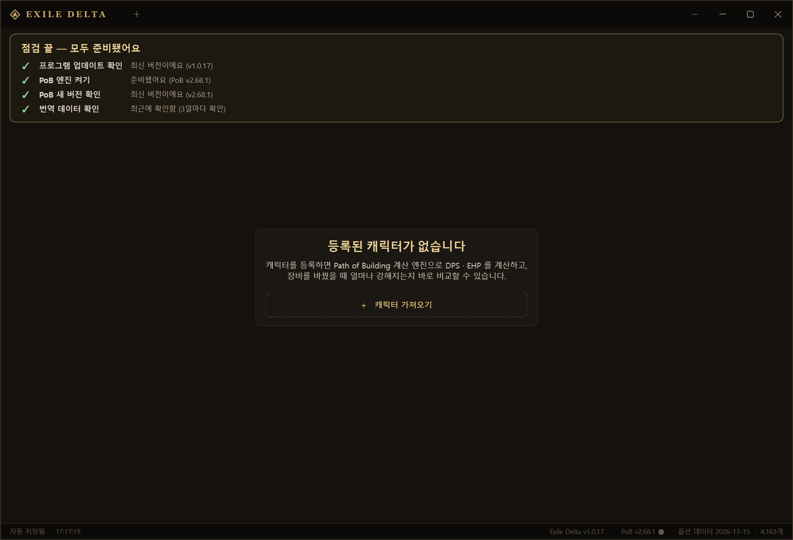

켤 때마다 프로그램 업데이트, PoB 엔진 새 버전, 번역 데이터를 확인합니다.
새 리그로 PoB가 업데이트되면 **내 캐릭터로 먼저 계산이 잘 되는지 점검한 뒤에** 넘어가기 때문에, 패치 날에도 안심하고 쓸 수 있습니다.

그 밖에 아이템 만들기, 슬롯별 최적 옵션 추천(베타)도 있습니다.

---

## 설치

1. [Releases](../../releases/latest)에서 `ExileDelta-버전.zip`을 받아 아무 폴더에 풉니다.
2. `ExileDelta.exe`를 실행합니다.
   서명되지 않은 프로그램이라 Windows가 "PC 보호" 경고를 띄울 수 있습니다. **추가 정보 → 실행**을 누르면 됩니다.
3. 처음 켜면 두 가지를 자동으로 받습니다.
   - 이 저장소에 더 새 버전이 올라와 있으면 그 버전을 받고 다시 켜집니다.
   - 계산에 쓰는 PoB 엔진(약 370MB)을 PoB 공식 GitHub에서 받습니다. 처음 한 번만 받습니다.
4. `+ 캐릭터 가져오기`로 캐릭터를 등록합니다.
   계정으로 불러오려면 pathofexile.com 프로필 → Privacy Settings에서 **Characters 탭을 공개**로 해 두어야 합니다.
5. 게임은 **창 모드 전체 화면(Windowed Fullscreen)** 으로 설정해 주십시오. 그래야 비교 창이 게임 위에 보입니다.
   게임을 관리자 권한으로 실행 중이라면 이 프로그램도 관리자 권한으로 실행해야 비교 창이 바로 포커스를 가져갑니다(Esc로 바로 닫기).

## 자주 묻는 질문

**Q. 계정이 정지되거나 하지는 않습니까?**
게임 파일이나 메모리를 건드리지 않습니다. 게임에서 원래 되는 `Ctrl+C`(아이템 텍스트 복사)를 읽어서 계산할 뿐입니다.

**Q. 개인 정보를 어디로 보냅니까?**
접속하는 곳은 pathofexile.com(캐릭터 정보), github.com(PoB 엔진 · 프로그램 업데이트), repoe-fork.github.io(번역 데이터)뿐입니다. 그 외에는 아무 곳에도 보내지 않습니다.

**Q. POE2도 됩니까?**
지금은 POE1 전용입니다.

**Q. 메모리는 얼마나 씁니까?**
약 600MB입니다. 그중 절반 이상은 PoB 엔진을 화면 없이 켜 둔 몫입니다. PoB를 직접 켰을 때와 비슷한 수준입니다.

---

## 업데이트는 어떻게 되나

exe를 매번 새로 받을 필요가 없게 만들었습니다.

프로그램을 켤 때마다 이 저장소의 최신 릴리스를 확인하고, 새 버전이 있으면 그동안 바뀐 내용을 보여 주면서 업데이트할지 물어봅니다.
여러 버전이 밀려 있으면(예: 1.0.0을 쓰는데 1.0.3까지 나옴) 1.0.1, 1.0.2, 1.0.3 내용을 모두 보여 줍니다.
"지금 업데이트"를 누르면 몇 초 만에 받아서 다시 켜지고, "이 버전 건너뛰기"를 누르면 다음 버전이 나올 때까지 묻지 않습니다.

메뉴(☰) → "프로그램 업데이트 확인"으로 직접 확인할 수도 있고, 지난 업데이트 내용은 메뉴의 "업데이트 내역 보기"나 아래 상태 표시줄의 버전 글씨를 누르면 볼 수 있습니다.

### 릴리스에 올라가는 파일

릴리스 하나에 파일이 세 개씩 올라갑니다. 직접 받을 파일은 첫 번째 하나뿐입니다.

| 파일 | 크기 | 용도 |
|---|---|---|
| `ExileDelta-버전.zip` | 약 53MB | **처음 설치할 때 받는 파일입니다.** 안에 `ExileDelta.exe` 하나가 들어 있습니다. 파이썬, Qt 같은 실행에 필요한 것과 그 버전의 프로그램 코드가 모두 들어 있습니다. |
| `app-버전.zip` | 약 1.5MB | 업데이트할 때 프로그램이 알아서 받는 파일입니다. 프로그램 코드(`app/`)와 옵션/번역 데이터(`data/`)만 들어 있습니다. |
| `manifest.json` | 1KB 미만 | 최신 버전 번호, 코드 파일 주소, 정상 파일의 지문(SHA-256)이 적혀 있습니다. 프로그램이 업데이트를 확인할 때 읽습니다. |

### 업데이트할 때 실제로 일어나는 일

1. 켜지면 `manifest.json`을 읽어서 지금 버전보다 새 버전이 있는지 확인합니다. 시험판(Pre-release)으로 올린 버전은 무시합니다.
2. 업데이트를 누르면 53MB짜리 exe가 아니라 `app-버전.zip`(1~2MB)만 받습니다.
3. 받은 파일의 지문이 `manifest.json`에 적힌 값과 다르면 깨진 파일로 보고 설치하지 않습니다.
4. `%LOCALAPPDATA%\ExileDelta\app\버전\`에 풀고 프로그램을 다시 켭니다.
5. exe는 그대로 두고, 켜질 때 그 폴더에 있는 새 코드로 실행됩니다. exe는 일종의 실행기 역할만 합니다.

새 버전이 켜지다가 계속 죽으면(3번 연속으로 정상 시작을 못 하면) 그 버전은 고장 난 것으로 표시하고 이전 버전으로 돌아갑니다.
이전 버전 폴더는 하나씩 남겨 두고, 그보다 오래된 것은 지웁니다.

### exe를 새로 받아야 하는 경우

대부분은 코드만 바꿔서 업데이트되지만, 새 라이브러리를 넣거나 파이썬 버전을 올리는 것처럼 exe 자체가 바뀌어야 하는 경우가 가끔 있습니다.
그럴 때는 업데이트 창 대신 "새 설치 파일이 필요합니다"가 뜨고, 누르면 다운로드 페이지가 열립니다. 새 `ExileDelta-버전.zip`을 받아서 덮어쓰면 됩니다. 설정과 캐릭터는 그대로 남습니다.

## 파일이 어디 저장되나

- 설정, 등록한 캐릭터: `%APPDATA%\ExileDelta\`
- PoB 엔진, 받은 업데이트, 로그: `%LOCALAPPDATA%\ExileDelta\`

예전 이름(Exile Sieve)으로 쓰던 분은 새 버전을 처음 켤 때 예전 폴더가 자동으로 옮겨집니다. 예전 프로그램은 끄고 켜 주십시오.

## 어떻게 계산하나

PoB는 화면을 그리는 실행기(C++)와 계산을 전부 담당하는 Lua 코드로 되어 있습니다.
이 프로그램은 PoB 공식 릴리스의 Lua 코드를 [lupa](https://github.com/scoder/lupa)(LuaJIT)로 화면 없이 실행하고, PoB 내부의 아이템 비교 · 계산 함수를 직접 호출합니다.
그래서 계산식을 따로 만들지 않고 PoB와 같은 결과가 나오며, PoB가 새 리그에 맞춰 업데이트되면 그 내용이 그대로 반영됩니다.

## 직접 빌드하기

```powershell
python -m pip install -r requirements.txt
python app\main.py                                          # 개발 모드로 바로 실행
powershell -ExecutionPolicy Bypass -File .\build.ps1 -NoRun  # dist\ExileDelta.exe 만들기
```

- Windows 10/11, Python 3.12 기준으로 만들고 있습니다.
- `app/`은 화면과 기능(PySide6), `app/pob/`은 PoB 엔진 연결 부분입니다. 계산은 별도 프로세스에서 합니다.
- exe의 시작점은 `launcher/launcher.py`입니다. 앱 코드는 exe에 컴파일해 넣지 않고 파일로 읽어서 실행합니다. 그래야 업데이트로 받은 코드가 쓰이기 때문입니다. `tools/pack_app.py`가 `app-버전.zip`과 `manifest.json`을 만들고, 업데이트 처리는 `app/app_update.py`에 있습니다.
- 옵션/번역 데이터(`data/*.json`)는 `build.ps1 -RefreshData`로 다시 만들 수 있습니다.
- 릴리스를 낼 때는 `app/version.py`의 버전을 올리고 `release.ps1 -NotesFile 변경내용.md`를 실행하면 빌드부터 GitHub 업로드까지 한 번에 됩니다. `-Pre`를 붙이면 시험판으로 올라가서 자동 업데이트 대상에서 빠집니다.

## 고마운 프로젝트들

- [Path of Building Community](https://github.com/PathOfBuildingCommunity/PathOfBuilding) (MIT): DPS/EHP 계산은 전부 PoB로 합니다. 프로그램에 넣어서 배포하지 않고, 실행할 때 공식 릴리스를 받아서 씁니다.
- [RePoE fork](https://repoe-fork.github.io/): 아이템 옵션, 영문/한글 문장 데이터
- [Awakened PoE Trade](https://github.com/SnosMe/awakened-poe-trade) (MIT): 한글 클라이언트 문장과 이름 데이터 보충
- [PySide6](https://doc.qt.io/qtforpython/), [lupa](https://github.com/scoder/lupa), [requests](https://github.com/psf/requests)

## 라이선스

[MIT](LICENSE)입니다. 자유롭게 쓰고, 고치고, 배포하셔도 됩니다.

## 알림

**이 프로그램은 Grinding Gear Games와 관련이 없으며, Grinding Gear Games가 승인하거나 보증한 것이 아닌 개인이 만든 팬 도구입니다.**
Path of Exile과 관련 이름, 데이터의 권리는 Grinding Gear Games에 있습니다.

*This product isn't affiliated with or endorsed by Grinding Gear Games in any way.*
